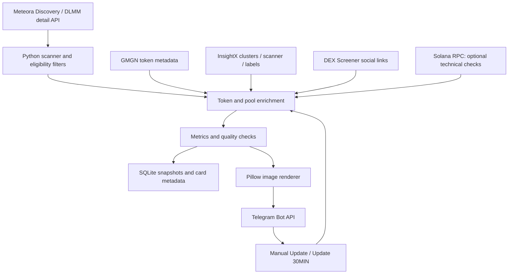
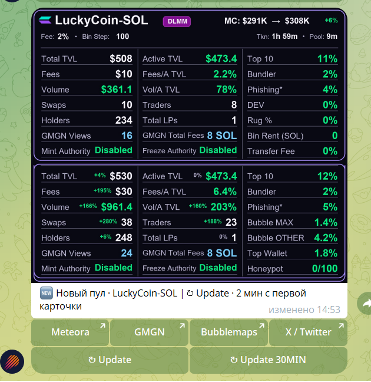

# Meteora DLMM Radar

**Solana DLMM liquidity-pool monitoring and risk analytics bot · Python · Telegram · SQLite**

[Русская версия](README_RU.md) · [Architecture](docs/architecture.md) · [Metrics](docs/metrics.md) · [Data sources](docs/data_sources.md) · [Testing & limitations](docs/testing.md) · [Roadmap](docs/roadmap.md)

## Overview

Meteora DLMM Radar is an AI-assisted Python automation project designed to discover newly created **Meteora DLMM pools on Solana**, evaluate configurable market and pool conditions, and send compact analytical cards to Telegram. Each card combines pool liquidity and fee metrics, token-level risk signals, links to research tools, and manual refresh controls.

**Purpose:** reduce repetitive manual screening of liquidity pools while keeping final trading decisions with the user. **Not** an AI prediction engine or an automated trading/execution bot.

## Key capabilities

- Poll Meteora's DLMM discovery and pool-detail endpoints; screen candidates by configurable market-cap, base-fee, recent-fee and age conditions.
- Generate a **two-panel Telegram image**: the original snapshot is preserved, while the lower panel shows the refreshed pool state.
- Show liquidity, fees, trading activity and ratios such as **Fees / Active TVL** and **Volume / Active TVL**.
- Enrich token information from GMGN and risk/cluster data from InsightX, where available.
- Show **Bubble MAX**, **Bubble OTHER**, an *estimated* **Top Wallet** excluding recognizable infrastructure addresses, and a **Honeypot risk score**.
- Link to Meteora, GMGN, Bubblemaps and X; prioritize verified X profiles, communities and direct post URLs before token-address search.
- Support **Update** and **Update 30MIN** actions, plus searchable Telegram token hashtags.
- Persist discovered pools and card metadata using SQLite; guard against duplicate card submissions and multiple concurrent local instances.

## Architecture



See [Architecture](docs/architecture.md) for state flow, refresh behavior, and component responsibilities.

## Technologies

Python 3.12 (local tested environment), `requests`, `python-dotenv`, `Pillow`, `sqlite3` (standard library), JSON/REST APIs, Telegram Bot API, Solana RPC, Windows batch shortcut.

## Repository layout

```text
meteora-dlmm-radar/
├── radar.py                 # Public code snapshot (beta; live validation ongoing)
├── README.md                # English project introduction
├── README_RU.md             # Russian project introduction
├── CHANGELOG.md             # Technical changes
├── requirements.txt
├── .env.example             # Placeholders only; never real credentials
├── .gitignore
├── docs/
│   ├── architecture.md
│   ├── architecture_RU.md
│   ├── metrics.md
│   ├── metrics_RU.md
│   ├── data_sources.md
│   ├── testing.md
│   └── roadmap.md
└── screenshots/
    └── telegram_card.png   # Add approved non-sensitive screenshot
```

## Running locally

Create a Python environment, install `pip install -r requirements.txt`, copy `.env.example` to `.env` and fill in credentials **locally**, then run `python radar.py` from the repository directory. Keep exactly **one** bot process active for a Telegram token and SQLite database. The current Windows working copy is version-named (`Radar_V46.py`) and can be started with a desktop shortcut; the public snapshot can use the stable filename `radar.py` once verified.

> **Publication status:** documentation prepared from the V46 source while live verification is ongoing. Code is included as a beta portfolio snapshot; live validation and fixes are ongoing, and production reliability is not claimed. Provider permissions, quotas and response formats may change.

## Responsible interpretation

A low Honeypot score does **not** guarantee price safety. Wallet cluster metrics are from InsightX, **not** Bubblemaps; the two providers use different inference methods. `Top Wallet` is the largest available candidate remaining after identifiable technical wallets are excluded, not a verified independent owner. Empty or stale API responses are represented as unavailable rather than fabricated data.

This is a **portfolio and research automation project**, not investment advice.

## Development Approach — AI-Assisted Development

This project was developed using an AI-assisted workflow.

**My contributions:** Project concept, requirements definition, selection of liquidity and risk metrics, monitoring logic, API integration planning, functional testing, data validation, and iterative improvements.

**AI assistance:** Python code generation, implementation support, debugging, integration troubleshooting, and technical documentation.

The project demonstrates practical experience in AI-assisted automation development, API integration, testing, and turning requirements into a working technical solution.

The Python source code was developed with AI assistance rather than written entirely by me.

## Demo screenshot


