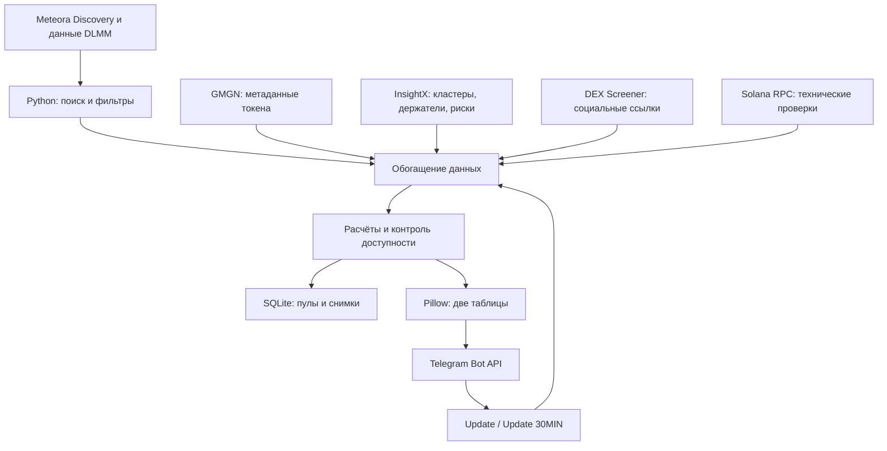
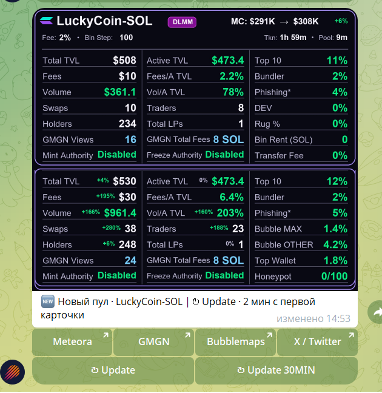

# Meteora DLMM Radar

**Бот мониторинга и аналитики пулов ликвидности Solana · Python · Telegram · SQLite**

[English README](README.md) · [Архитектура](docs/architecture_RU.md) · [Показатели](docs/metrics_RU.md) · [Источники](docs/data_sources.md) · [Проверки](docs/testing.md)

## Назначение

Meteora DLMM Radar — самостоятельный проект Python-автоматизации для обнаружения новых **DLMM-пулов Meteora в сети Solana**, первичного отбора по настраиваемым критериям, сбора показателей из нескольких сервисов и отправки компактных аналитических карточек в Telegram.

Цель — **сократить ручной мониторинг и ускорить первичную оценку рисков**. Бот **не торгует автоматически**, не гарантирует доходность и не является моделью AI-прогнозирования.

## Возможности

- Регулярное сканирование Meteora Discovery/детальных данных; фильтрация по возрасту пула, капитализации, базовой комиссии и комиссиям за установленный период.
- Telegram-карточка с **двумя таблицами**: верхняя фиксирует первоначальное состояние пула, нижняя показывает данные на момент обновления.
- Показатели TVL, Active TVL, комиссии, объём, сделки, число трейдеров, LP, держателей и отношения **Fees / Active TVL**, **Volume / Active TVL**.
- Интеграция метаданных GMGN и доступных аналитических сигналов InsightX.
- Показатели концентрации связанных кошельков **Bubble MAX / Bubble OTHER**, предварительный **Top Wallet** и **Honeypot 0–100**.
- Ссылки на Meteora, GMGN, Bubblemaps, X: приоритет профиля, сообщества, конкретной публикации; при отсутствии — поиск по адресу токена.
- Кнопки **Update** и **Update 30MIN**, поисковые хэштеги токенов в подписях Telegram.
- Хранение записей в SQLite, защита от повторной отправки карточек и от второго экземпляра бота на одном компьютере.

## Архитектура

Полная схема: [docs/architecture_RU.md](docs/architecture_RU.md).

## Технологии

Python 3.12, `requests`, `python-dotenv`, `Pillow`, встроенный `sqlite3`, REST/JSON, Telegram Bot API, API Meteora/GMGN/InsightX/DEX Screener, Solana RPC. Локальный запуск в Windows 11 через ярлык.

## Как запускать

Для локального запуска: `pip install -r requirements.txt`, создать локальный `.env` по `.env.example`, затем `python radar.py`. **Не запускать два экземпляра одновременно.** В рабочей Windows-папке пока используется файл с номером версии (`Radar_V46.py`), а в GitHub основной файл будет иметь постоянное имя `radar.py`.

## Ограничения

- `Honeypot = 0/100` означает отсутствие обнаруженных сканером технических ограничений, а **не** отсутствие мошеннических или рыночных рисков.
- **Bubble MAX / Bubble OTHER рассчитываются по InsightX**, а не по самой карте Bubblemaps. Результаты двух сервисов могут не совпадать.
- `Top Wallet` — **предварительная оценка** крупнейшего нетехнического кандидата. Метки могут отсутствовать; InsightX иногда не возвращает список держателей.
- Источники могут иметь лимиты API, задержки и неполные ответы. При отсутствии данных используется `н/д`.
- Показатели комиссий и объёма в текущих карточках связаны с окном Meteora **30 минут**; две кнопки обновления используют разные способы показа изменений.

**Статус:** опубликован исходный код тестируемой версии; проект развивается, некоторые интеграции требуют дополнительной проверки на реальных данных.

## Пример карточки Telegram

